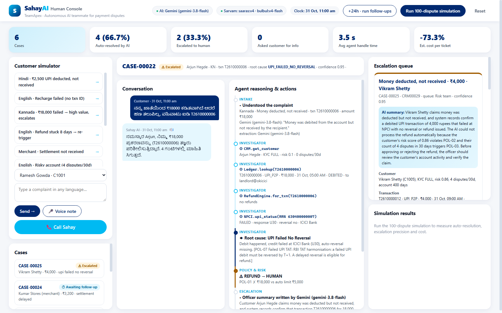

# Sahay AI — an autonomous AI teammate for payment disputes

**TeamApex** · Track 3: Autonomous AI Teammates · Paytm Build for India AI Hackathon, Bengaluru (Oct 2026)

Sahay resolves payment disputes ("money deducted but not received", failed recharge, stuck refund,
merchant settlement not received) from complaint to closure. It understands the customer in their own
language, by chat or by voice call. It investigates across back-office systems, decides under policy, and
takes action: refunds, refund re-triggers, bank tickets and settlement re-pushes. It escalates to a human
with a ready case brief only when it must, and follows up until the money arrives.



> Hackathon prototype. All Paytm back-office systems are **mocked** and all customer data is synthetic.
> Not affiliated with or endorsed by Paytm.

## Highlights

- **Acts, not just answers.** It calls ledger, UPI/NPCI, recharge, settlement, refund and CRM systems, then takes the action.
- **Policy before money.** Every money movement passes deterministic policy checks (`sahay/policy.py`).
  The LLM understands and writes; it never decides a refund.
- **Escalates only when needed.** High-value, risky or ambiguous cases go to a human with evidence, the policy
  that blocked them, and a Gemini-written summary. One click approves or rejects.
- **Voice agent in Indian languages.** "📞 Call Sahay" holds a spoken conversation (Sarvam speech-to-text and
  text-to-speech). It works in Hindi, Kannada, Tamil and English, plus other languages through Sarvam translation.
- **Follows up.** A simulated clock lets you jump ahead 24 h. Sahay checks each refund, bank ticket and settlement, then closes the case.
- **Measured.** A 100-dispute simulation with hidden ground truth produces the impact metrics.
- **Works offline.** Without API keys (or if a provider fails) it falls back to a rules engine and built-in replies.

## Quick start

Requires Python 3.10+.

```bash
git clone <this-repo-url> sahay-ai && cd sahay-ai
python -m venv .venv
# Windows: .venv\Scripts\activate    macOS/Linux: source .venv/bin/activate
pip install -r requirements.txt
cp .env.example .env        # optional: add GEMINI_API_KEY and SARVAM_API_KEY
python -m uvicorn sahay.app:app --host 127.0.0.1 --port 8080
```

Open **http://127.0.0.1:8080**. Or use `./run.ps1` (Windows) or `./run.sh` (macOS/Linux).

Docker:

```bash
docker build -t sahay-ai .
docker run --env-file .env -p 8080:8080 sahay-ai
```

On Windows, open `127.0.0.1` rather than `localhost`. `localhost` tries IPv6 first and adds about 2 s to every request.

## Configuration

| Variable | Purpose |
|---|---|
| `GEMINI_API_KEY` | Google Gemini (`gemini-3.8-flash`). Reads complaints in any language and writes officer summaries |
| `SARVAM_API_KEY` | Sarvam AI: `saaras:v4` speech-to-text, `sarvam-translate` / `mayura` translation, `bulbul:v4-flash` text-to-speech |
| `LLM_API_KEY` | Optional OpenAI-compatible alternative (e.g. NVIDIA NIM) if no Gemini key |
| `SAHAY_STEP_DELAY` | Pause between agent steps in the console (default `0.5` s), so viewers can follow the reasoning |

See `.env.example` for all options. Click the **AI** or **Sarvam** badge in the console header to run a live check of both providers.

## Demo walkthrough (about 4 minutes)

1. **Hindi · ₹2,500 UPI deducted.** Intake → tool calls (CRM, Ledger, Refund engine, NPCI) → root cause
   *UPI failed, no reversal* → policy ✓ → refund → Hindi reply with ETA → follow-up scheduled.
2. **English · recharge failed, no txn ID.** Sahay finds the transaction by amount and type itself.
3. **Kannada · ₹18,000.** Policy blocks the refund (POL-01, ₹5,000 limit) and an escalation brief appears. Click **Approve & execute**.
4. **Risky account.** POL-02 and POL-03 fail, so the case goes to the risk team. Click **Reject** with a note.
5. **Actually credited.** No money moves. The customer gets proof (the UPI RRN), which avoids a wrong refund.
6. **UPI pending at bank.** A refund is *not* allowed (POL-08), so Sahay raises a UDIR bank ticket instead.
7. **+24h · run follow-ups.** Refunds complete, the bank confirms and settlements credit. Sahay verifies each one and closes the case.
8. **Tamil · ₹1,800.** Sarvam translates the complaint in and the reply back to Tamil.
9. **📞 Call Sahay.** Pick a customer and talk to Sahay:
   - Sahay greets the customer in their language.
   - It listens until the customer pauses.
   - It says "checking your transaction" while the agents work, then speaks the outcome.
   - It asks "anything else?". Say "no, thank you" to end the call.
   - If it asks for the transaction ID, read it out. A one-digit mishearing is matched safely against that customer's own transactions.
10. **Run 100-dispute simulation.** Produces the impact metrics below.

You can also type any complaint in the simulator. If Sahay can't identify the transaction safely, it asks instead of guessing.

## Architecture

```
Customer — chat · voice note · live voice call (Sarvam STT/TTS)
        │
  Orchestrator (sahay/agents.py) — case state, reasoning trail, follow-ups
   ├─ Intake          language, issue, txn ID, amount         (Gemini; rules fallback)
   ├─ Investigator    CRM · Ledger · NPCI UPI · Operator · Settlements · Refund engine
   ├─ Policy & Risk   every action vs. 10 policies → ALLOW / HUMAN   (deterministic)
   ├─ Action          refund · re-trigger · UDIR ticket · settlement re-push · notify
   └─ Escalation      case brief + Gemini summary → Human Console (approve / reject)
        │
  Mock Paytm systems (sahay/systems.py, also at /mock/*) + audit log (/api/audit)
```

| Path | What |
|---|---|
| `sahay/agents.py` | Orchestrator and the five agents |
| `sahay/policy.py` | Policy knowledge base (10 rules) and per-action checks |
| `sahay/systems.py` | Mock Paytm APIs; every write is audited |
| `sahay/store.py` | In-memory state with a simulated clock |
| `sahay/seed.py` | Scripted demo cases and a synthetic dispute generator with hidden ground truth |
| `sahay/llm.py` | Gemini client (native REST); OpenAI-compatible alternative |
| `sahay/sarvam.py` | Sarvam speech-to-text, translation, text-to-speech |
| `sahay/voice_agent.py` | Spoken phrases, reply-to-speech cleanup, call intents |
| `sahay/lang.py` | Language detection; English, Hindi and Kannada reply templates |
| `sahay/metrics.py` | 100-dispute simulation (`python -m sahay.metrics 100`) |
| `sahay/app.py` | FastAPI: case API, voice/call endpoints, WebSocket feed, mock APIs |
| `static/index.html` | Human console (single page, no build step) |
| `tests/` | Offline tests (`python -m unittest -v`) |

**Tech stack:** Python, FastAPI, Uvicorn, WebSockets, httpx · Google Gemini · Sarvam AI · HTML/CSS/JS · Docker.

### Main endpoints

| Method & path | Purpose |
|---|---|
| `POST /api/cases` | Open a case from a customer message |
| `POST /api/cases/{id}/reply` | Customer reply (e.g. the txn ID) |
| `POST /api/cases/{id}/decision` | Human approve / reject an escalation |
| `POST /api/call/start`, `POST /api/call/turn` | Voice agent: greeting, then one spoken turn at a time |
| `POST /api/voice`, `POST /api/tts` | Voice note → case; text → speech |
| `POST /api/clock/advance` | Move the simulated clock and run follow-ups |
| `POST /api/simulate` | Run the dispute simulation |
| `GET /api/integrations/test` | Live check of Gemini and Sarvam |
| `GET /mock/*`, `GET /api/audit` | Mock back-office systems and the audit trail |
| `WS /ws` | Live case and reasoning updates |

## Results: 100 synthetic disputes (seed 7)

| Metric | Value |
|---|---|
| Auto-resolution rate (no human) | **74%** |
| Escalation precision | **85.7%** (18 of 21 escalations were needed) |
| Escalation recall | 85.7% (3 hidden-fraud cases on low-risk accounts were missed) |
| Asked the customer for the txn ID (ambiguous) | 5% |
| Estimated change in cost per ticket | **−80.7%** |

Caveats:
- The disputes are synthetic. Ground truth comes from the generator and is hidden from the agents.
- The simulation runs on the rules engine. Live Gemini and Sarvam calls add a few seconds per case.
- The cost estimate assumes ₹45 per human-handled ticket, ₹3 per AI ticket, and that a human with a ready
  case brief needs 60% of the usual time (`sahay/metrics.py`).

## Tests

```bash
python -m unittest -v
```

Covers every scripted scenario end to end, including follow-ups. It also covers policy limits, language detection, the voice-agent helpers, the simulation thresholds and the API. No keys or network needed.

## Roadmap

- A real phone line (Exotel or Twilio) with Sarvam streaming speech-to-text, and interrupting Sahay mid-reply
- Policy retrieval over real policy documents (pgvector); LangGraph port of the orchestrator
- PostgreSQL / Redis persistence; OpenTelemetry tracing
- Connectors to real ledger, UPI and refund systems in place of the mocks
